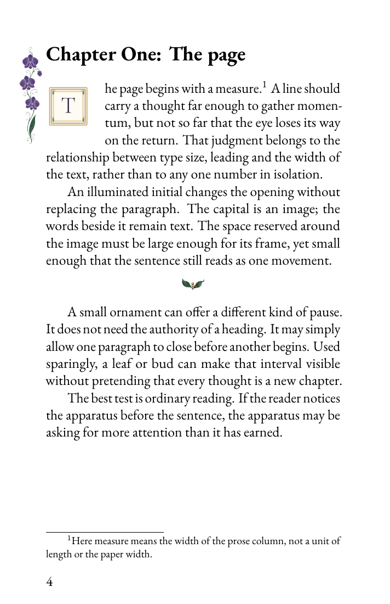
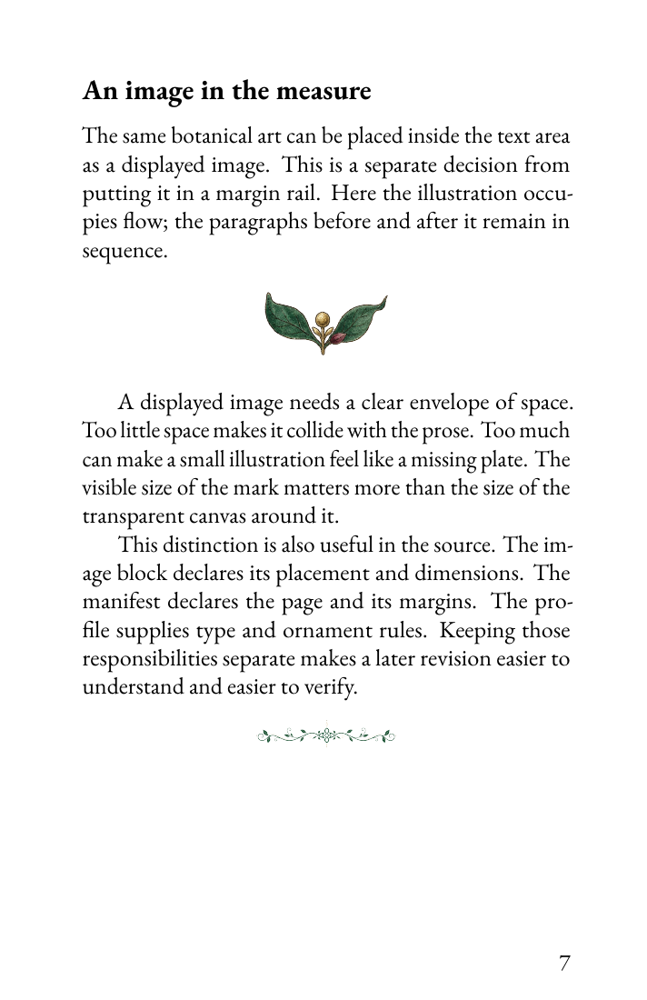

# Optical Foundry

Optical Foundry turns Markdown manuscripts and YAML render manifests into print-ready PDFs through Pandoc and LuaLaTeX. It separates the manuscript, its visual profile and its delivery settings, and writes a JSON evidence file for each render: inputs, resolved resources, warnings, validation checks, page count and the output's SHA-256. Use it for a single document or an assembled book, then inspect both the evidence and the pages before delivery.

## A small book, built from source

[The Shape of a Page](examples/illuminated-book/) is an eleven-page example set in 14pt type, with an illuminated initial, displayed imagery, three botanical rail designs, four ornament slots, contents, footnotes and a glossary. Its text was written for the example; its decorative art comes from the Codex 0 collection. Everything needed to render it is in this repository.

<p>
  
  
</p>
<p>
  
  
</p>

## What it does

- Render one Markdown document directly, or use a typed YAML manifest for repeatable builds.
- Assemble multiple sources into a book with title pages, contents and section dividers.
- Keep imagery explicit with `of-image` and `of-initial` blocks.
- Declare bound margins, folios and illumination rails under `render.delivery`.
- Fill engine-native ornament slots from a profile package, with page-position rules.
- Render Mermaid, Vega, D2 and Graphviz figures when their local tools are installed.
- Produce booklet/signature impositions and advisory bindery preflight reports.
- Record source hashes, resource selection and output evidence alongside the PDF.

Demo profiles ship here; other profiles live in a separate repository and are loaded through the [profile-package mechanism](engine/profile_package.py).

## Requirements

The example has been exercised with Python 3.12 and 3.13, Pandoc 3.7 and TeX Live 2025. Install:

- Python, [uv](https://docs.astral.sh/uv/) and the Python packages shown below;
- Pandoc;
- LuaLaTeX and a sufficiently complete TeX Live installation, including EB Garamond and TeX Gyre fonts;
- Poppler tools (`pdfinfo`, `pdftotext`, `pdffonts`, `pdfimages`) for evidence and preflight;
- XeLaTeX for the safe-area guide/overlay sidecars, and `qpdf` for independent PDF checks.

No proprietary fonts or external profile checkout are required by this example. Diagram CLIs are optional and are not used in it.

## Quickstart

From the repository root:

```bash
uv venv --python python3
uv pip install PyYAML Pillow pytest
.venv/bin/python examples/illuminated-book/render.py
.venv/bin/python examples/illuminated-book/verify.py
```

The render script gives profile discovery a temporary home/config and unsets `OF_PROFILE_PATH`. Its only profile pointer names the bundled example profile, so it does not consult your personal profile repositories.

Outputs are written under `generated/illuminated-book/`:

- `illuminated-book.pdf` — eleven half-letter pages;
- `illuminated-book.evidence.json` — render and validation evidence;
- `illuminated-book.bindery_preflight.json` — advisory print checks;
- safe-area guide and overlay PDFs.

The verifier checks success, warnings, page count, output hash, resource locality, ornament/image wiring and legacy-tree boundaries. It is not a substitute for looking at the pages. The example is a prototype proof, not a vendor-certified press file: its images are RGB and it has no bleed. Read the preflight report before sending any output to a printer.

### Other CLI entry points

Run these with your Python environment active, from the repository root:

```bash
python -m cli --help
python -m cli profiles
python -m cli doc path/to/manuscript.md --profile document-spine --output generated/document
python -m cli manifest path/to/book.yaml --output generated/book
python -m cli impose --help
python -m pytest -q
```

The example's custom profile is selected by its render script; a direct `manifest` call needs that package on the profile search path. See its [README](examples/illuminated-book/README.md) for the file layout and known limitations.

## Documents, manifests and bundles

A **document** is one Markdown source. A **manifest** declares a render target: source, profile, metadata and delivery settings. A `markdown_document` manifest preserves single-document semantics; a **bundle** manifest assembles an ordered graph of sources and may insert dividers and other book-level material. A **profile** supplies visual defaults, templates and optional composition rules. Generated PDFs and evidence are outputs, not source manuscripts.

## Repository map

| Path | Purpose |
| --- | --- |
| [`examples/`](examples/) | Self-contained book source, manifest and example profile |
| [`cli/`](cli/) | `python -m cli` entry points |
| [`engine/`](engine/) | Compilers, profile/resource resolution and source preparation |
| [`renderers/`](renderers/) | Pandoc-backed rendering |
| [`profiles/`](profiles/) | Bundled demo defaults, templates, styles and assets |
| [`contracts/`](contracts/) | Rendering and extension contracts |
| [`schemas/`](schemas/) / [`validators/`](validators/) | Manifest shapes and validation |
| [`fixtures/`](fixtures/) / [`tests/`](tests/) | Test inputs and pytest suite |
| [`docs/`](docs/) | Guides, design notes and implementation records |

## Documentation

- [Architecture](DESIGN.md)
- [Render manifests](contracts/RENDER_MANIFESTS.md)
- [Bundle assembly](contracts/BUNDLE_ASSEMBLY.md)
- [Profile expansion](contracts/EXPANSION.md)
- [Ornament slots](contracts/ORNAMENT_SLOTS_CONTRACT.md)
- [Images and wrapping](docs/guides/figure-wraps.md)
- [Illuminated image initials](docs/guides/illuminated-image-initials.md)
- [Imposition](contracts/IMPOSITION.md)
- [Bound delivery details](docs/bound-delivery-status-2026-05-18.md)
- [Example source and profile guide](examples/illuminated-book/README.md)

Some design records describe earlier interfaces. Use `python -m cli --help` for the implemented command surface and report a mismatch rather than assuming a historical example still runs.
