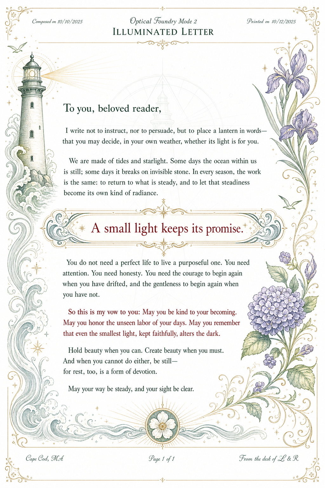

# Illuminated Letter Profile Path

## Context

After comparing the final rendered **typeset letter** artifact with the true handwritten/illustrated **hand-made letter** artifact, the useful renderer gap became clearer.

The goal is **not** to die on the hill of handwriting. Handwriting is one possible intimacy signal, but the more important transferable features are:

- semantic artwork integrated with the page;
- motif-driven ornaments and illustrations;
- color emphasis that means something;
- page-rhythm review through screenshots/contact sheets;
- ceremonial thresholds, pull quotes, and closing seals;
- a repeatable profile path that can make dense personal letters feel carried by beauty rather than merely typeset.

## Path decision

### 1. Stationery-plus mode — explicitly wanted

Stationery-plus mode should be treated as a desired Foundry capability.

It extends the existing Johannah mythic-letter profile without becoming a full page-composition engine.

Likely features:

- stable Johannah stationery header/footer;
- multiple named raster-art slots beyond a single `header_art`;
- optional transparent PNG overlays;
- motif-aware header, margin, watermark, and closing-seal assets;
- semantic color roles for selected lines;
- automatic PDF rasterization and contact-sheet generation for artifact review;
- no-overwrite preview output directories.

This is the practical bridge between current typeset-letter rendering and more embodied mythic artifacts.

### 2. Illuminated mode — confirmed current goal for the new profile

After generating three `gpt-image-2` concept renders for stationery-plus, illuminated letter, and page-composition modes, Luis confirmed that **Mode 2 / illuminated letter** is what he wants.

The current goal for the new profile is therefore an **illuminated letter** mode.

This should remain Pandoc/LaTeX-backed, but allow source annotations and YAML/frontmatter fields to carry intentional artifact semantics.

Likely capabilities:

- semantic source annotations such as vow, confession, blessing, thesis, pull quote, or closing blessing;
- profile-level color palette roles for those annotations;
- named art slots such as opening threshold art, motif illustration, margin emblem, pull-quote panel, closing tailpiece, watermark sigil, and footer glyph;
- generated or selected raster artwork integrated as part of the artifact language;
- support for readable typed body text while allowing selected script/handmade-style elements when useful;
- evidence outputs that include page screenshots/contact sheets, not only the final PDF.

This should be the near-term profile-design target.

## Codex 0 analogue

Luis also wants something like Mode 2 for **Codex 0**.

This should not be interpreted as immediately pulling generalized page-composition mode into scope. The safer architecture is to treat Codex 0 as needing an **illuminated codex artifact treatment** that borrows Mode 2's principles at book/section scale:

- motif-driven section openers;
- semantic color roles for vows, theses, blessings, and warnings;
- integrated raster illustrations, diagrams, seals, and tailpieces;
- page/contact-sheet evidence for artifact rhythm;
- readable typeset prose as the base layer;
- mythic visual language that makes Codex 0 feel embodied rather than merely compiled.

Potential future profile family names:

- `illuminated-letter` for personal letter artifacts;
- `illuminated-codex` for Codex 0 / book-scale mythic objects.

The Codex 0 analogue should remain compatible with the existing codex bundle / manifest architecture. It should be a render profile or profile family applied to the compiled Codex artifact, not a replacement for Codex 0 source assembly governance.


## Visual target asset

The confirmed Mode 2 concept render is committed as a durable Foundry planning asset:



Use this image as a **visual target reference**, not as a literal template. It captures the desired direction: readable typeset prose, semantic color, integrated motif art, illuminated emphasis, margin/threshold ornaments, and a closing ritual layer.

## One-shot image generation hypothesis

A promising near-term implementation path is **not** one-shot generation of the final page with text baked in. Image models are still unreliable for exact text, pagination, and revision control.

The better fit is a **one-shot decorative-asset pipeline**:

1. Foundry/agent derives a motif packet from the letter or codex section.
2. A prompt template generates white-background or flat-background raster assets for specific slots:
   - margin cutouts;
   - opening threshold art;
   - quote/highlight ornaments;
   - emphasis panels;
   - closing seals/tailpieces;
   - watermark sigils.
3. A deterministic pass converts white/flat backgrounds to alpha when needed.
4. LaTeX/Pandoc owns all real text, line breaks, quotes, and semantic emphasis boxes.
5. Foundry composes the generated art modules into named slots and emits contact-sheet evidence for review.

Transparency caveat: in the current configured OpenAI/Codex image lane, direct `gpt-image-2` transparent-background generation rejected with `Transparent background is not supported for this model`. Treat native transparency as provider/model/account-dependent, not guaranteed. The reliable local path is to generate isolated ornament assets on pure white or another flat key background, then run deterministic white-to-alpha/key-to-alpha cleanup before composition.

This fits inside illuminated mode because it keeps the renderer deterministic where determinism matters, while letting image generation supply the mythic ornament layer.

## Out of scope for now

### Page composition mode — deferred until after Codex 0

Full page-composition mode is out of scope until after **Codex 0** is done.

That mode would treat each page as an explicit designed field rather than relying primarily on linear document flow. It may eventually support page plans such as:

```yaml
pages:
  - role: threshold
    art: opening_threshold
    emphasis: salutation
  - role: density
    art: margin_emblem
    emphasis: pull_quote
  - role: closing
    art: closing_seal
    emphasis: blessing
```

But implementing that as a general Foundry subsystem would be a larger architecture step. Until Codex 0 is complete, page-composition experiments may happen **ad hoc** for individual artifacts, but they should not become the main profile mandate.

## Practical implementation order

1. Keep the existing Johannah mythic-letter profile stable.
2. Add stationery-plus support first: additional art slots, semantic color roles, contact-sheet evidence.
3. Use a typeset letter and a hand-made letter as reference artifacts for validating the feel.
4. Build illuminated mode / Mode 2 as the new profile target with explicit source annotations and motif-art slots.
5. Preserve the Codex 0 analogue as a desired future illuminated-codex treatment that remains compatible with codex bundle/manifest assembly.
6. Defer generalized page-composition planning until after Codex 0, except for manual one-off experiments.

## Design compression

Do not make Foundry chase handwriting. Make Foundry able to carry mythic meaning through **stationery, semantic color, motif artwork, illuminated emphasis, and closing ritual** while preserving readability and repeatable render mechanics.
